<p align="center">
  
</p>

---

### Outil open source de gestion d'aquariums pour aquariophiles.


## Membres de l'équipe

1. Audor Etienne ( project leader )
2. Vachey Joris
3. Morrain Nolan
4. Moisan Clement
5. Moreau Quentin

## Stack Technique

- **Frontend** : Next.js 16 (App Router), React 19, TypeScript, Material UI (`@mui/material`, `@mui/x-data-grid`), `react-hook-form` + `yup`
- **Backend** : Next.js API Routes, NextAuth, Prisma ORM (`@prisma/adapter-better-sqlite3`, `@prisma/adapter-pg`)
- **Base de données** : SQLite en local (`better-sqlite3`) et support PostgreSQL (`pg`) via Prisma
- **Qualité & Tests** : ESLint, Prettier, Husky, Commitlint, Vitest, Playwright

## Extensions VS Code Recommandées

Pour garantir un environnement de développement homogène, installez les extensions suivantes :

* ESLint
* Prettier - Code formatter
* GitLens
* Error lens
* Conventional commit
* Pretty TypeScript Errors
* Auto Rename Tag
* Import Cost
* MUI Snippets
* SQLite Viewer

## Démarrage Rapide

Depuis le dossier `fishkeeper` :

1. Copier le fichier d'environnement :

	```powershell
	Copy-Item .env.example .env
	```
	La variable `NEXTAUTH_SECRET` contient un token personnel propre a chaque machine, on peut en obtenir un grace a la commande:   
	```powershell
	openssl rand -base64 32
	```
	Il faut cependant avoir installé au préalable cette methode.

2. Installer les dépendances :

	```powershell
	npm install
	```

3. Générer le client Prisma :

	```powershell
	npm run db:generate
	```

4. Créer la base SQLite et appliquer les migrations :

	```powershell
	npm run db:migrate
	```

	Cette commande crée le fichier `dev.db` à partir des migrations présentes dans `prisma/migrations`.

5. Peupler la base de données :

	- **Peuplement global des espèces** (catalogue complet des espèces) :
		```powershell
		npm run db:seed
		```
	- **Peuplement de développement / test** (données fictives et jeux de test locaux) :
		```powershell
		npm run db:seed:dev
		```

		Comptes locaux créés pour les tests :
		- **USER** : `demo@fishkeeper.fr` / `Test1234!`
		- **ADMIN** : `admin@fishkeeper.fr` / `Test1234!`

6. Lancer le projet :

	```powershell
	npm run dev
	```

L'application est ensuite accessible à l'adresse http://localhost:3000.

## Gestion de la base de données

Supprimer puis recréer la base locale en réappliquant toutes les migrations :

```powershell
npm run db:reset